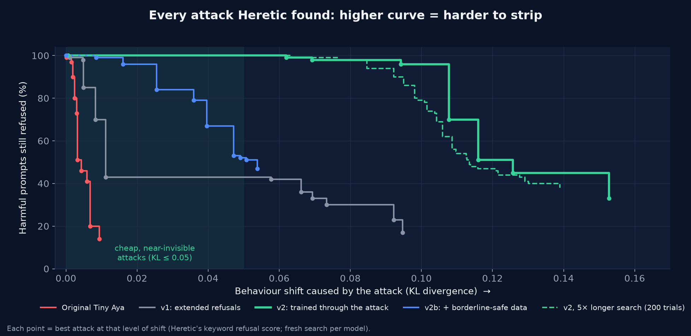

# 🛡️ Heretic-Resistant Tiny Aya

**A free one-command attack strips Tiny Aya's safety training. We trained it to keep refusing anyway — and measured exactly what that costs.**

*Lexsi Labs × Cohere × Hugging Face AI Safety & Alignment Hackathon · Track 2b: AI Safety and Correction · Problem statement 12: Tamper resistance*

## Results at a glance

| | Original Tiny Aya | Our v2 |
|:--|:--:|:--:|
| [**Under attack:** answers judged harmful after Heretic's best found attack](results/guard_judge_day6/summary.jsonl) | 🔴 **91%** | 🟢 **40%** |
| [Refusal kept under cheap attacks (KL ≤ 0.05)¹](results/day6/summary.jsonl) | 14% | **100%** |
| [Lexsi SafeTune's direction-removal attack: harmful](results/guard_judge_day6/summary.jsonl) | 55% | **0%** |
| [Harmful outside English (Hindi, Arabic, French, Spanish)²](results/multilingual/summary.jsonl) | 41% | **12%** |
| [**Clean:** general knowledge (MMLU)³](results/day6/summary.jsonl) | 52.3% | 53.0% |
| [Instruction following (IFEval)⁴](results/general_audit/clean_results.json) | 77.5% | **67.5%** |
| [Safe questions refused (XSTest over-refusal)⁵](results/general_audit/clean_results.json) | 17.2% | 42.8% (v2b: 16.8%) |

Harm and refusal rows use 100 harmful prompts (`mlabonne/harmful_behaviors` test); "harmful" is judged by IBM's Granite Guardian, refusal labels are classifier output. ¹ Heretic's own keyword refusal score; KL is how far an attack shifts the model on harmless prompts (low KL ≈ behaves like the original). ² A softer prompt set (aya_redteaming, pooled). ³ 1,000-question clean evaluation, a descriptive aggregate, not an equivalence test; a paired 200-item audit measured −0.5 points [−5.6, +4.6] for v2. ⁴ 200 prompts. ⁵ 250 safe-but-risky-sounding XSTest prompts, provisional ProtectAI labels. Paired clean-checkpoint audits: HumanEval −1.2 [−7.3, +4.9], CyberMetric −1.4 [−3.7, +0.8] — similar on these samples, not demonstrated equivalent. [Full capability tables](docs/GENERAL_CAPABILITY_RESULTS.md). [Evidence index: per-item scores and run configs](docs/EVIDENCE.md).

Each dot is the best attack found at a given behaviour shift: the original (red) collapses at low KL, v2 (green) holds across the cheap-attack zone; a 5× longer search found similar worst-case harm (42% vs 40%, overlapping intervals — not an equivalence test).

**What it does not stop:** prefill attacks and harmful fine-tuning break every checkpoint — A1 only delays (numbers in the track's ask below). Full per-attack matrix: [docs/DETAILS.md §8](docs/DETAILS.md#8-attack-resistance-matrix-what-it-stops-and-what-it-doesnt).

## Models

| Model | What it is | Hugging Face |
|---|---|---|
| Original | Cohere's Tiny Aya Global, 3.35B (gated: accept Cohere's terms) | [CohereLabs/tiny-aya-global](https://huggingface.co/CohereLabs/tiny-aya-global) |
| v1 | Fine-tuned on explained refusals only | [StarWarrior24x7/tiny-aya-global-xref-v1](https://huggingface.co/StarWarrior24x7/tiny-aya-global-xref-v1) |
| **v2** | **Main result: trained through the attack** | [StarWarrior24x7/tiny-aya-global-xref-v2](https://huggingface.co/StarWarrior24x7/tiny-aya-global-xref-v2) |
| v2b | v2 + borderline-safe questions (less over-refusal) | same repo, `subfolder="v2b"` |
| A1 | v2 + RepNoise: delays harmful fine-tuning | [StarWarrior24x7/tiny-aya-global-phaseA-v2-repnoise](https://huggingface.co/StarWarrior24x7/tiny-aya-global-phaseA-v2-repnoise) |
| A2 | v2 + Booster: negative result | [StarWarrior24x7/tiny-aya-global-phaseA-v2-booster](https://huggingface.co/StarWarrior24x7/tiny-aya-global-phaseA-v2-booster) |

## How it works

- **Threat:** refusal lives mostly along one direction in the model's internal activity (Arditi et al. 2024); Heretic edits it out of the weights in about an hour on a free GPU.
- **Defense:** LoRA fine-tuning (~2 h on a free T4) where, on 50% of steps, the refusal direction — re-estimated from the *current* model every 100 steps — is projected out of every layer and the model must still refuse harmful prompts and answer benign ones, using only self-generated data (2,355 rows, published). The attacker adapts as the model learns. Follows *Fool's Gold* and *ART*, adapted to a refusal target with no hazardous data. v2b adds borderline-but-safe data to reduce over-caution.
- **Evaluation:** a fresh Heretic search per model; refusal (keyword + ProtectAI) and *harm* (Granite Guardian, the main safety number, 95% Wilson intervals) measured separately — under attack, v2 often rewrites a harmful request into a harmless answer instead of refusing; Llama Guard 3 cross-checks non-English harm. Method diagram, training config, judges and every per-attack table: [docs/DETAILS.md](docs/DETAILS.md).

**Hackathon repos:** SafeTune extracts the refusal directions our training attack removes and attacks each checkpoint with direction ablation and CAA steering; AuditKIT probes and evaluates the hardened models; CircuitKIT was attempted for circuit analysis (GPU-bound). Four bugs found along the way were fixed with regression tests and merged upstream: AuditKIT [#35](https://github.com/Lexsi-Labs/AuditKIT/pull/35) and [#36](https://github.com/Lexsi-Labs/AuditKIT/pull/36), CircuitKIT [#37](https://github.com/Lexsi-Labs/CircuitKIT/pull/37), SafeTune [#79](https://github.com/Lexsi-Labs/SafeTune/pull/79) (via [#77](https://github.com/Lexsi-Labs/SafeTune/pull/77)).

## Against the track's ask

> *"Make safety survive later harmful fine-tuning by someone else, and demonstrate it with attack fine-tunes"*
>
> - **Abliteration:** resisted by v2 in these evaluations (above).
> - **Harmful fine-tuning:** **no model prevents it.** v2 delays the collapse briefly (89% refusal after 5 attack steps at lr 2e-4 vs 8% original, ~5% for both by step 10; [A0](results/phaseA_A0/summary.jsonl), 100 `harmful_behaviors` prompts; the held-out HarmBench-193 run below gives 94% vs 3% at step 5). On held-out HarmBench-193, A1 (v2 + RepNoise) holds out about 3–4× longer (breaks between steps 100–175 vs 25–50 at lr 2e-5, one attack seed; [scores](results/phaseA_finetune/README.md)) at the cost of about half of v2's coding passes.
> - **Our claim is delay, not prevention,** with each defense's cost measured alongside.

## Limitations

- **v2 is not unbreakable:** the strongest attack Heretic found on v2 still gets 40% harmful answers. That attack shifted the model's normal behaviour ~16× more than the one that broke the original (KL 0.153 vs 0.009); this is what these searches found, not a proven minimum.
- **Not free:** instruction following −10.0 points [−16.7, −3.2] (v2), −19.5 (v2b); safe-question refusal +25.6 [+19.2, +31.8] (v2b fixes this but loses maths); parser-sensitive maths −13.0 strict, −1.0 numeric. One model size (3.35B), one training seed.
- **Judges are AI models,** so two independent ones are used plus a cross-check; refusal labels are provisional classifier output. v1 alone, a straight Fool's Gold replication and T4-sized CircuitKIT discovery did not work. Bugs we found, fixed and re-ran: [full honesty section](docs/DETAILS.md#13-limitations-failures-and-honest-corrections).

## Cost and real-world value

About 37 GPU-hours total, almost all free Kaggle T4s (about $13 at on-demand prices) plus about $5 rented A10; the defense itself costs about 1–3 T4-hours (about $1) once, against about 1 T4-hour (about $0.35) to strip the original. Projected serving (estimated, not a measured deployment): one always-on T4 ≈ $256/month GPU-only for 1M requests — cheapest closed APIs are about half that, mid-tier 4–10× the GPU cost. Tiny Aya and derived models are CC-BY-NC-4.0; commercial use needs Cohere's permission. Table and sources: [docs/DETAILS.md §15](docs/DETAILS.md#15-cost-and-real-world-value).

## Submission materials

- **Abstract for the entry form:** [docs/ABSTRACT.md](docs/ABSTRACT.md)
- **Artifacts:** models v1, v2 (+ `v2b/`), A1, A2 with cards → [models collection](https://huggingface.co/collections/StarWarrior24x7/heretic-resistant-tiny-aya-models-6af3e1eff9a91556f5535934); training data, Heretic journals, judge scores, logs → [data & results collection](https://huggingface.co/collections/StarWarrior24x7/heretic-resistant-tiny-aya-data-and-results-6af3e1f03fff746c25b4884c); interactive results explorer → [Hugging Face Space](https://huggingface.co/spaces/StarWarrior24x7/heretic-resistant-tiny-aya); code, run configs, decision log → this repo. **Never published:** stripped models, their raw outputs, refusal-direction tensors, credentials.
- **Reproduce:** `python scripts/rebuild_numbers.py` rebuilds every number on this page from `results/` (standard library, no GPU) and checks it against the text. Free Kaggle T4s (FP16); one T4 loads v2. Quick-start code, every job folder, figure scripts, model/dataset/licence tables: [docs/REPRODUCE.md](docs/REPRODUCE.md) — note the single-BOS tokenisation detail (the chat template already adds BOS). Heretic's scoring prompts were excluded from training; XSTest never trained on; 200 OR-Bench prompts held out; an audit found two normalized prompt duplicates and no train/eval overlap under the declared lexical checks.
- **With more credits:** turn the prefill pilot into a claim (retrain, re-attack, 128-token judging); CircuitKIT discovery on a 40 GB+ GPU; Aya Expanse 8B for scaling; code-mixed languages; multi-seed attack runs. Proposed targets, not validated results: [roadmap](docs/DETAILS.md#16-roadmap).

## Team and references

| Member | Contributions |
|---|---|
| **Shivendu** ([@StarWarrior24x7](https://huggingface.co/StarWarrior24x7)) | Threat demo; v1/v2/v2b defenses; adaptive evaluation; Lexsi toolkit integration and the 4 upstream fixes; single-BOS re-evaluation; Phase A fine-tuning defenses (A1, A2) and held-out tests with predictions and Granite re-judge; article, explorer, brief |
| **Abhinav** ([@laterabhi](https://huggingface.co/laterabhi)) | Granite Guardian harm judging; Heretic-200; multilingual evaluation with Llama Guard cross-check; ROI; judge-style fresh-clone review with consistency and overclaim fixes, the stop-token fix and the HF sync script |
| **Aban** ([@abanwild](https://huggingface.co/abanwild)) | Found the double-BOS bug; prefix-recovery pilot with matched and benign controls; tokenisation fix; ROI model check; frozen paired capability audit of v2, v2b, A1 and A2 (IFEval, GSM8K, HumanEval, MMLU, CyberMetric, XSTest) |

**References:** Arditi et al. 2024; Heretic (p-e-w); arXiv 2505.19056; Fool's Gold (arXiv 2608.17202); ART (arXiv 2605.26526); DeepRefusal (arXiv 2509.15202); TAR (Tamirisa et al. 2024); TamperBench (KDD 2026); Qi et al. 2023; XSTest (Röttger et al. 2024); OR-Bench (Cui et al. 2024); Granite Guardian (Padhi et al. 2024); The Multilingual Alignment Prism (Aakanksha et al. 2024).

---

Built during the hackathon, almost entirely on free GPUs, for safer open-weight models. Every number above comes from <code>results/</code> and <code>notes/LOG.md</code>.

