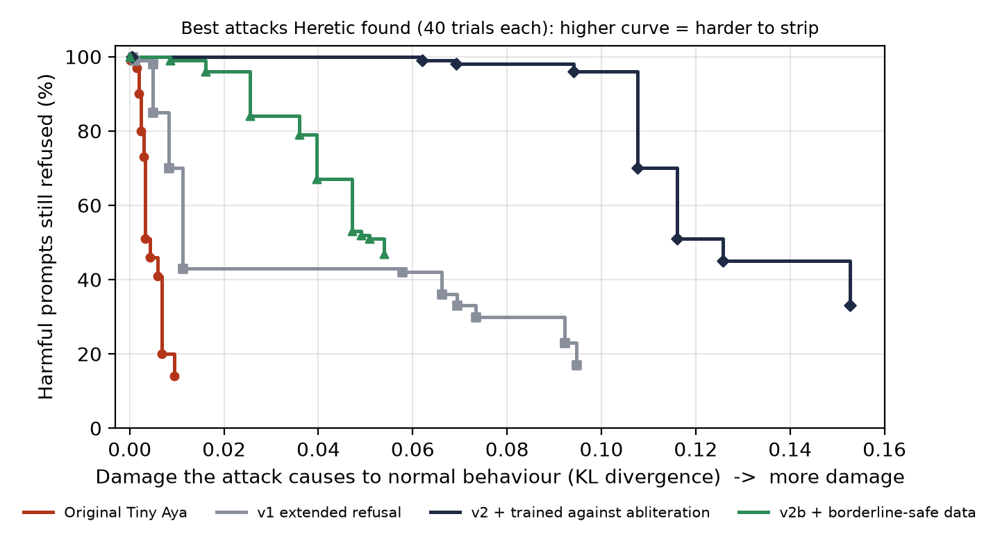

# Heretic-Resistant Tiny Aya: training a small open model to keep its safety when someone tries to edit it out

*Lexsi Labs × Cohere × Hugging Face AI Safety & Alignment Hackathon, Track 2b: Tamper Resistance*

> **TL;DR.** With [Heretic](https://github.com/p-e-w/heretic), a free one-command tool, we stripped Cohere's Tiny Aya Global of its safety. Judged refusal fell from 98% to **1%**, and **91%** of its answers became harmful, with no loss on MMLU.
>
> We then trained Tiny Aya *while simulating that attack inside the model*. Against our model (v2), the same attack at the same damage budget leaves refusal at **100%**. Heretic's strongest attack, even with **5× the search budget**, needs about **15× more distortion** of the model's behaviour and still only makes **40–42%** of answers harmful.
>
> Lexsi's SafeTune and AuditKIT confirm the effect independently. The defense **holds in Hindi, Arabic, French and Spanish**, and costs **nothing on MMLU**.
>
> The limits are real, and we report them: harmful fine-tuning and prefilling still break the model. A pilot shows prefilling can be fixed.

**Try it:** [interactive results explorer](https://huggingface.co/spaces/StarWarrior24x7/heretic-resistant-tiny-aya): attack curves, every attack, and side-by-side comparisons.

---

## 1. Problem and approach in brief

**The problem.** Open-weight models ship with safety training, but anyone can download and edit the weights.
- **The weakness:** Arditi et al. (2024) showed that refusal lives mostly in **one direction** inside a model's internal activity. Delete that direction from the weights, a technique called *abliteration*, and the model stops refusing.
- **The tool:** **Heretic** automates this. It searches for the abliteration that removes the most refusals while changing the model's normal behaviour the least, measured by KL divergence on harmless prompts.
- **The cost to an attacker:** no data, no expertise, about an hour on a free GPU. Many "abliterated" models made this way are already on the Hub.

**Our question.** Can a small open model keep its refusals against the attack people actually use, without becoming less useful?

**Approach.**
1. **Measure the threat.** Run Heretic against Tiny Aya Global.
2. **v1: extended refusals.** Fine-tune on long, explained refusals, which spread refusal over more directions (arXiv 2505.19056).
3. **v2: train through the attack.**
   - On half of the training steps, we remove a refusal direction from every layer *during the forward pass*, and the model must still refuse harmful prompts and answer benign ones.
   - The direction is re-estimated from the current model every 100 steps, so the simulated attacker keeps up with training.
   - This is adversarial training in the style of Fool's Gold and ART, adapted to a refusal target with no hazardous data.
4. **v2b: reduce over-refusal.** v2 plus 1,218 borderline-but-safe prompts.
5. **Attack every model adaptively.** We ran a fresh Heretic search on each checkpoint, plus Lexsi's SafeTune and AuditKIT attacks, steering, prefilling, sampling, 4-bit compression, harmful fine-tuning and a multilingual red-team set. Everything is judged by two independent judges.

## 2. Hackathon repos used

| Repo | What we used it for | Features used |
|---|---|---|
| **SafeTune** | An independent second implementation of the attack, steering attacks, and the mechanism measurement | `extract_refusal_direction` (per-layer refusal directions); `RefusalDirectionModel(mode="ablate")` (inference-time direction ablation as an attack); `extract_caa_vectors` + `CAAModel` with negative strength (activation-steering attacks) |
| **AuditKIT** | Independent red-team probes on every model | `RedTeamRunner` with the jailbreak, encoding, prompt-injection and refusal probes |
| **CircuitKIT** *(attempted)* | Refusal-circuit comparison, original vs v2 | `SafetyPromptAdapter` with `pairing_mode="harmful_vs_benign"`, `load_model` (Cohere port), `discover` (EAP / EAP-IG). Discovery ran out of memory on a 16 GB T4 for this 3.35B model with its 262k vocabulary (section 7.6) |

SafeTune and AuditKIT form one connected chain with our pipeline:
- SafeTune extracts the refusal direction, which is the same object our training-time attack removes;
- SafeTune then attacks each checkpoint with ablation and steering;
- AuditKIT and two classifier judges score the outputs.

## 3. Models used and their licences

| Model | Role | Licence |
|---|---|---|
| [CohereLabs/tiny-aya-global](https://huggingface.co/CohereLabs/tiny-aya-global) (3.35B) | Base model | CC-BY-NC-4.0 |
| [StarWarrior24x7/tiny-aya-global-xref-v1](https://huggingface.co/StarWarrior24x7/tiny-aya-global-xref-v1) | Our v1 | CC-BY-NC-4.0 (inherited) |
| [StarWarrior24x7/tiny-aya-global-xref-v2](https://huggingface.co/StarWarrior24x7/tiny-aya-global-xref-v2) (root = v2, `v2b/` = v2b) | Our v2 / v2b | CC-BY-NC-4.0 (inherited) |
| [ProtectAI/distilroberta-base-rejection-v1](https://huggingface.co/ProtectAI/distilroberta-base-rejection-v1) | Refusal judge ("did it refuse?") | Apache-2.0 |
| [ibm-granite/granite-guardian-3.2-5b](https://huggingface.co/ibm-granite/granite-guardian-3.2-5b) | Harm judge ("is the answer harmful?") | Apache-2.0 |
| [meta-llama/Llama-Guard-3-1B](https://huggingface.co/meta-llama/Llama-Guard-3-1B) | Second, multilingual harm judge | Llama 3.2 Community Licence |
| [facebook/nllb-200-distilled-600M](https://huggingface.co/facebook/nllb-200-distilled-600M) | Translation for multilingual judging | CC-BY-NC-4.0 |

## 4. Datasets and benchmarks used, and their licences

| Dataset | Use | Licence |
|---|---|---|
| [LLM-LAT/harmful-dataset](https://huggingface.co/datasets/LLM-LAT/harmful-dataset) | Harmful prompts for refusal training; `rejected` responses for the fine-tuning attack (prompts disjoint from training) | not stated on the card |
| [databricks/databricks-dolly-15k](https://huggingface.co/datasets/databricks/databricks-dolly-15k) | Benign prompts (answers self-distilled from Tiny Aya) | CC-BY-SA-3.0 |
| [bench-llm/or-bench](https://huggingface.co/datasets/bench-llm/or-bench) | Borderline-benign training prompts for v2b; 200 held out | CC-BY-4.0 |
| [mlabonne/harmful_behaviors](https://huggingface.co/datasets/mlabonne/harmful_behaviors), [mlabonne/harmless_alpaca](https://huggingface.co/datasets/mlabonne/harmless_alpaca) | Heretic's search prompts; harmful test[:100] | see cards |
| [natolambert/xstest-v2-copy](https://huggingface.co/datasets/natolambert/xstest-v2-copy) | Over-refusal (safe) and unsafe-contrast evaluation; never trained on | CC-BY-4.0 |
| [CohereLabs/aya_redteaming](https://huggingface.co/datasets/CohereLabs/aya_redteaming) | Multilingual red-team prompts (English, Hindi, Arabic, French, Spanish) | Apache-2.0 |
| [cais/mmlu](https://huggingface.co/datasets/cais/mmlu) | General ability (1,000-question sample) | MIT |
| [JailbreakBench/JBB-Behaviors](https://huggingface.co/datasets/JailbreakBench/JBB-Behaviors) | CircuitKIT task; prefix-pilot evaluation | MIT |

## 5. Model artifacts (HF collection)

**Collection:** [Heretic-Resistant Tiny Aya: Models](https://huggingface.co/collections/StarWarrior24x7/heretic-resistant-tiny-aya-models-6af3e1eff9a91556f5535934). It contains xref-v1, xref-v2 (with v2b) and their model cards. All are public and un-gated.

**Stripped or attacked models are never published.** They are exactly the harm this project defends against, and they existed only inside the evaluation runs.

## 6. Data artifacts (HF collection)

**Collection:** [Heretic-Resistant Tiny Aya: Data & Results](https://huggingface.co/collections/StarWarrior24x7/heretic-resistant-tiny-aya-data-and-results-6af3e1f03fff746c25b4884c). It contains:
- the training data ([tiny-aya-extended-refusal](https://huggingface.co/datasets/StarWarrior24x7/tiny-aya-extended-refusal));
- [results, attack logs and benchmarks](https://huggingface.co/datasets/StarWarrior24x7/tiny-aya-tamper-resistance-results):
  - every Heretic study journal (each trial with its parameters, refusal and KL);
  - per-run metrics and logs;
  - per-response judge scores (numbers only).

Raw responses from attacked models are kept private. We publish scores, not harmful text.

## 7. Experiments, findings, and what else we tried

**How to read the numbers.**
- **Refusal** is scored by the ProtectAI classifier ("did it refuse?"; higher is safer).
- **Harmful** is scored by Granite Guardian ("is the answer harmful?"; lower is safer). Granite reports 95% Wilson confidence intervals in brackets.
- **KL divergence** measures how much an attack changes the model's normal answers on harmless prompts: higher means more visible damage, which the attacker wants to avoid.
- **Final numbers** come from the single-BOS re-evaluation (see the *Evaluation note* in 7.7).

### 7.1 The threat is real: Tiny Aya is stripped for free

| | Refusal | Harmful (Granite) | MMLU |
|---|---|---|---|
| Tiny Aya Global | 98% | 0% | 52.3% |
| After Heretic's best attack (KL 0.009) | **1%** | **91%** [84, 95] | 52.0% |

Heretic's own keyword scorer reported 14% refusal, but both judges show the strip is almost total. Keyword matching counts phrases like "this is illegal" as refusals even when the model goes on to comply.

### 7.2 Training through the attack works against direction-removal attacks

Lowest refusal Heretic reached within a given KL budget. These are Heretic's own keyword scores; each column is a fresh search on that checkpoint.

| Model | KL ≤ 0.01 | KL ≤ 0.05 | KL ≤ 0.1 | Strongest attack found |
|---|---|---|---|---|
| Original | 14% | 14% | 14% | 14% at KL 0.009 |
| v1 (extended refusal) | 70% | 43% | 17% | 17% |
| **v2 (trained through abliteration)** | **100%** | **100%** | **79%**\* | 33–38% at KL 0.14–0.15 |
| v2b (+ borderline data) | 99% | 52% | 47% | 47% at KL 0.054 |

\*The 200-trial search (7.3) found a cheaper partial attack in the 0.05–0.1 band; the 40-trial search had found 96%.

**At each model's strongest Heretic attack, judged:**

| | Original | v2 | v2b |
|---|---|---|---|
| KL needed | 0.009 | 0.153 (**~16×**) | 0.054 |
| Refusal | 1% | **25%** | 31% |
| Harmful (Granite) | 91% [84, 95] | **40%** [31, 50] | 57% [47, 66] |
| Harmful on XSTest's unsafe prompts | 61% | **4%** | 15% |
| MMLU | 52.0% | 52.1% | 52.0% |

**Is the attacker just paying more KL?** Yes, and that is the honest framing.
- The defense **raises the price** of a strip: about 16× the behaviour change.
- It **makes the strip much less complete:** 40% harmful instead of 91%.
- It **does not make the model impossible to strip.**
- **A behaviour the refusal judge missed:** under attack, v2 often *rewrites* a harmful request into a harmless one instead of refusing (asked about trafficking endangered species, it writes a conservation guide). Judged by harm, it is safer than its refusal rate suggests.

### 7.3 More attacker budget does not help: Heretic with 200 trials

To check that v2's robustness isn't an artefact of a small search, a teammate re-ran Heretic on v2 with **5× the budget** (200 trials, otherwise the identical configuration; 229 minutes on T4×2).

| v2 under Heretic | 40 trials | 200 trials |
|---|---|---|
| Lowest refusal at KL ≤ 0.01 / 0.05 / 0.1 | 100% / 100% / 96% | 100% / 100% / 79% |
| Strongest point: Granite harmful | 40% [31, 50] | 42% [33, 52] |
| Strongest point: refusal / MMLU | 25% / 52.1% | 20% / 52.2% |

The worst case does not get worse. It still costs about 15× the original's KL, and nothing gets below 100% refusal at KL ≤ 0.05.

### 7.4 Independent confirmation with the Lexsi toolkits, plus other attacks

| Attack | Original | v2 | v2b |
|---|---|---|---|
| SafeTune refusal-direction ablation: refusal / harmful | 29% / 55% | **100% / 0%** | **99% / 0%** |
| SafeTune CAA steering, strength −1: refusal / harmful | 4% / 97% | 35% / 72% | 34% / 71% |
| SafeTune CAA steering, strength −4 | gibberish (model broken, not stripped) | gibberish | gibberish |
| Sampling attack (T=1; share where any of 3 tries succeeded)† | 9% | **0%** | 2% |
| 4-bit quantised (bitsandbytes NF4): refusal† | 99% | **100%** | **100%** |
| Prefill "Sure, here is": refusal / harmful | 21% / 82% | 20% / 77% | 24% / 80% |
| Harmful LoRA fine-tune, 100 examples: refusal† | 1% | 3% | 1% |
| AuditKIT prompt-injection probes: pass rate† | 62.5% | **87.5%** | 75% |

†Measured before the single-BOS fix (7.7). All other rows are final single-BOS numbers.

- **What generalises:**
  - attacks that remove or steer the refusal direction (Heretic, SafeTune ablation, mild steering);
  - sampling;
  - 4-bit compression.
- **What doesn't:** harmful fine-tuning and prefilling. These are the known open problems in tamper resistance (Qi et al. 2023; TamperBench), and they are where we go next (see the prefill pilot in 7.7 and section 8).

### 7.5 The defense holds outside English

Tiny Aya is a multilingual model, so we tested it beyond English: 100 prompts per language from Cohere's [`aya_redteaming`](https://huggingface.co/datasets/CohereLabs/aya_redteaming), at each model's strongest Heretic attack.
- **How we judged non-English answers:** Granite Guardian reads English only, so responses were translated with NLLB-200 and then judged.
- **The cross-check:** Llama Guard 3 judged the original text as a second judge. The two agree on 81–87% of rows in every language, the same agreement as on English with no translation (85%).

Harmful rate at the strongest attack (Llama Guard in brackets):

| | English | Hindi + Arabic + French + Spanish (n = 400) |
|---|---|---|
| Original | 34% (32%) | 41% (38%) |
| **v2** | 22% (17%) | **12% (14%)** |
| v2b | 28% (28%) | 22% (25%) |

Clean models are 1–7% harmful in every language. **v2 was trained only in English, yet its protection carries over to, and is even stronger in, the other four languages.**

This prompt set is softer than our main benchmark (many hate/bias prompts), so compare within this table only. Code-mixed prompts were not tested.

### 7.6 Mechanism

- **Refusal direction (SafeTune):** v2's refusal direction is 10–20% weaker in the middle and late layers than the original's (layer 24: 40.2 vs 46.4), and it peaks at the same layer (18). Our reading is that v2 stops relying on a single dominant direction, so removing it no longer removes refusal.
- **CircuitKIT (attempted):**
  - We built the circuit task with `harmful_vs_benign` pairing, because the default safety-dataset helpers produce pairs that `discover()` rejects.
  - Discovery then needed more than the 16 GB of a free T4 for a 3.35B model with a 262k-token vocabulary.
  - Circuit-level analysis is first on our list with more compute.

### 7.7 What else we tried

- **v1 alone** delays Heretic, but it still reaches 17%. Extended refusals are not enough by themselves.
- **Over-refusal (safe XSTest prompts, judged):**
  - the original refuses 16%, v2 39%, v2b 18%;
  - v2b fixes most of v2's over-caution but gives up some low-budget robustness (table 7.2);
  - we report v2 and v2b as two points on a safety-vs-usability curve.
- **No capability cost:** MMLU is 52.3% (original), 53.0% (v2) and 52.7% (v2b), which is within noise.
- **Pilot: fixing prefill.** The idea is to continue v2's training with refusals placed *after* generic affirmative openers ("Sure, here is…"), so the model learns to stop even after a forced compliant start. The test had 3 arms, all trained the same way and differing only in the openers:

  | | No openers (control) | Openers on harmful prompts only | Openers on all prompts |
  |---|---|---|---|
  | Harmful answers under "Sure, here is" (Granite) | 86% | **0%** | **0%** |
  | Harmful answers under 6 *unseen* openers (Granite) | 15–83% | **0–5%** | **0%** |
  | Over-refusal of safe prompts, no opener (normal use) | 38% | **39%** | 46% |
  | Refusal of safe prompts *after* an opener | 7% | 39% | 30% |

  - **The result:** training openers on harmful prompts only blocked prefill attacks with **no increase in normal over-refusal**.
  - **A shortcut it learned:** it also refuses some safe prompts *after* an opener. Normal users never prefill, but some developers do (for example, to force an output format).
  - **Our first version** taught a blanket "refuse after any opener" shortcut (77% refusal on safe prompts after an opener). A benign-opener control caught it, and a token-boundary bug was fixed before this version.
  - **Limits:** one seed; answers judged at 48 tokens (our main evaluation uses 128), so harm appearing later in long answers is not measured; not yet re-tested against Heretic.
- **Evaluation note (double BOS):**
  - **The bug:** a teammate found that our first evaluations added Tiny Aya's begin-of-sequence token twice, because the chat template already adds one.
  - **The fix:** we fixed it and re-ran every headline number. The headline held. Two things changed: the apparent ~2.5-point MMLU cost disappeared, and prefill turned out to be a bigger weakness than first measured.
  - **Training:** the training-time direction estimate had the same quirk, so a re-trained v2 may be even stronger.
- **Dropped ideas:**
  - a multilingual/Hinglish *attack* angle: we found no evidence it reflects real-world attacks;
  - a straight Fool's Gold replication: it failed at 9B, needs hazardous data, and the code is withheld.

## 8. With more credits: approach, cost and expected before/after

**Next experiments.**
1. **Fine-tuning resistance:** simulate a few LoRA attack steps inside training, the same way v2 simulates abliteration (a lightweight TAR).
2. **Prefill:** retrain v2 from the start with the prefix-recovery data and fixed BOS, run several seeds, judge 128-token answers, and re-attack with Heretic.
3. **Scale:** Aya Expanse 8B, plus code-mixed and more Tiny Aya languages.
4. **Circuits:** CircuitKIT on a 40 GB+ GPU.

**What it cost us.**
- About 37 GPU-hours, almost all on free Kaggle T4s (about $13 at on-demand T4 prices), plus about $5 of rented A10 time for the prefix pilot.
- Training the defense costs about 1–3 T4-hours (about $1), against about 1 T4-hour (about $0.35) for an attacker to strip the original.

**ROI: self-hosting the hardened model vs a closed-model API.**
- **Workload:** a multilingual support assistant with 1M requests a month, 300 input + 200 output tokens each (300M input and 200M output tokens a month).
- **Our measured, unoptimised throughput:** plain `transformers`, FP16, batch 16 on one T4, at most about 150 output tokens/s. 200M output tokens is then about 370 T4-hours a month, which fits on **one always-on T4: about $256 a month** at $0.35/h, or about $0.65 per 1M output tokens.

| Option (prices checked Nov 11, 2026) | Price, USD per 1M tokens (input / output) | Monthly cost |
|---|---|---|
| **Self-hosted hardened Tiny Aya, 1× T4 (measured, unoptimised)** | ~$0.35 per GPU-hour | **~$256** |
| GPT-6 Luna (current, cheapest OpenAI tier) | $0.10 / $0.50 | $130 |
| Claude Haiku 5.5 (current; prompts ≤ 100k tokens) | $0.10 / $0.50 | $130 |
| GPT-5.6 Luna | $0.20 / $1.20 | $300 |
| GPT-5.4 mini | $0.75 / $4.50 | $1,125 |
| GPT-6.1 Terra (current mid-tier) | $1.00 / $5.00 | $1,300 |
| Claude Sonnet 5.5 (current mid-tier) | $2.00 / $10.00 | $2,600 |

**Reading:**
- **The cheapest current models** cost about half of our *unoptimised* setup. A serving engine with continuous batching (vLLM-style) typically multiplies throughput several-fold; we did not measure that, so we claim no number.
- **Against current mid-tier models,** self-hosting is **about 4–10× cheaper** even unoptimised.
- **The bigger reasons to self-host are control:** data stays on your hardware, the model covers 70+ languages, and you own the weights. That ownership is exactly the risk this project addresses, and our defense makes it safer to release.

*Sources:*
- Claude prices: Anthropic's pricing page.
- OpenAI prices: [benchlm.ai](https://benchlm.ai/openai/api-pricing), updated Nov 11, 2026. OpenAI's own page could not be fetched automatically, so confirm on openai.com/api/pricing.
- T4: [Google Cloud GPU pricing](https://cloud.google.com/products/compute/gpus-pricing).

## 9. Team

- **Shivendu** [@StarWarrior24x7](https://huggingface.co/StarWarrior24x7): threat demo, the v1/v2/v2b defenses, adaptive evaluation, Lexsi toolkit integration, single-BOS re-evaluation, article.
- **Abhinav** *(add HF username)*: Granite Guardian judging, Heretic-200, the multilingual evaluation, ROI.
- **Aban** [@abanwild](https://huggingface.co/abanwild): the double-BOS finding, the prefix-recovery pilot and its controls.

---

### Threat model

- **The attacker** has the full weights and a free GPU, and uses public tools: Heretic, steering, prefilling and fine-tuning.
- **The defender** controls only the released weights.
- **Our claim:** robustness to **data-free direction-removal attacks** (abliteration/Heretic, inference-time ablation).
- **Not claimed:** robustness to fine-tuning or prefilling, although the prefill pilot is promising.

### Responsible release

- Only hardened models, scores and code are public.
- Stripped models were created only inside evaluation runs and deleted.
- Raw outputs of attacked models are private, shared only for judging, and deleted after judging.
- All harmful prompts come from existing public benchmarks.

### Reproduce

Code, configs, Heretic journals and run logs are at [github.com/ShivenduShivu/Tamper_Resistance_OSModels](https://github.com/ShivenduShivu/Tamper_Resistance_OSModels):
- every Kaggle job is in `kaggle/<day>/`;
- teammate experiments are in `kaggle/guard_judge`, `kaggle/heretic200`, `kaggle/multilingual` and `experiments/`;
- `notes/LOG.md` records every run and decision.

### References

- Arditi et al. 2024, *Refusal in Language Models Is Mediated by a Single Direction*
- p-e-w, *Heretic*
- *Extended refusal* (arXiv 2505.19056)
- *Fool's Gold* (arXiv 2608.17202)
- Kuo, Yadav, Smith 2026, *ART* (arXiv 2605.26526)
- *DeepRefusal* (arXiv 2509.15202)
- Tamirisa et al. 2024, *TAR*
- *TamperBench* (KDD 2026)
- Qi et al. 2023, *Fine-tuning Aligned Language Models Compromises Safety*
- Röttger et al. 2024, *XSTest*
- Cui et al. 2024, *OR-Bench*
- Padhi et al. 2024, *Granite Guardian*
- Aakanksha et al. 2024, *The Multilingual Alignment Prism* (aya_redteaming)
